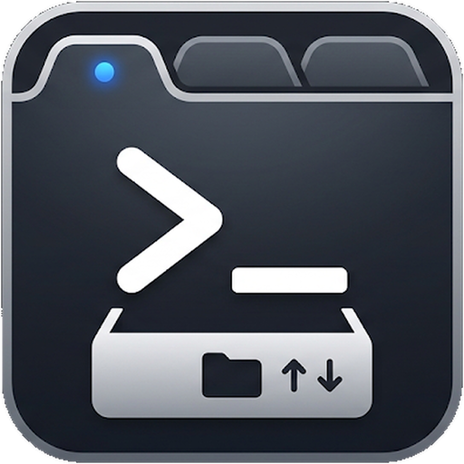
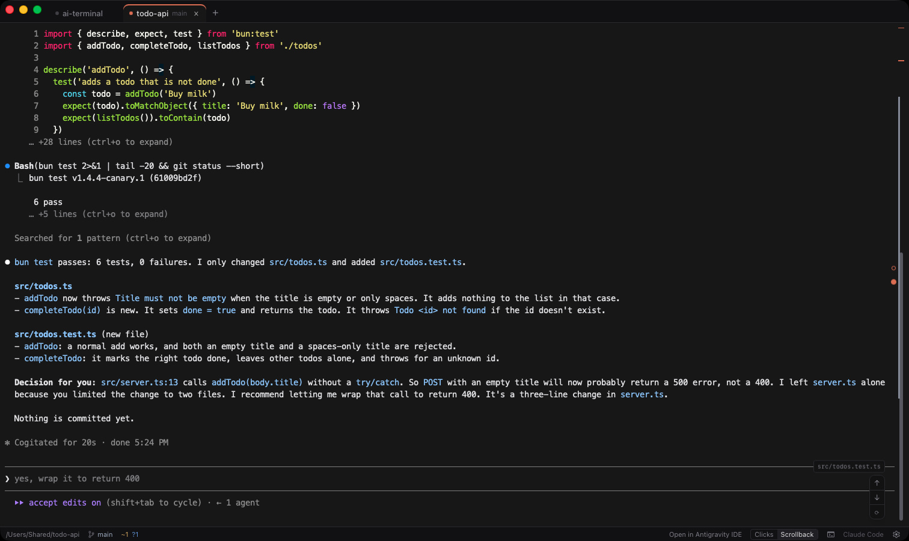
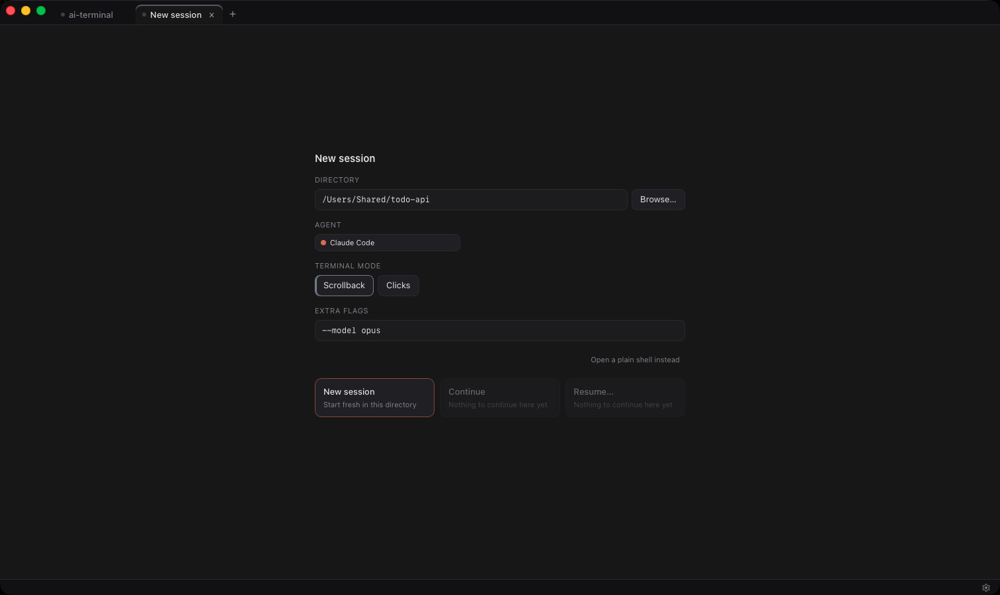
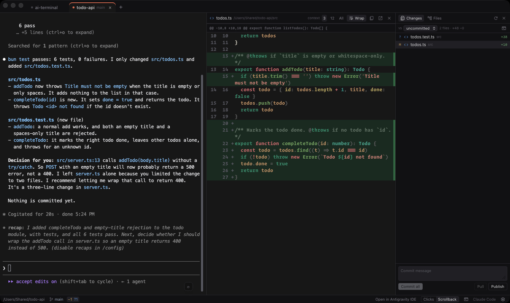

# Muster

[English](README.md) · **繁體中文** · [简体中文](README.zh-CN.md) · [日本語](README.ja.md)

**專為 AI 代理程式 CLI 打造的終端機。**



`claude`、`codex` 和 `agy` 的執行方式與在你平常的終端機裡完全相同——真正的 PTY、完整的 TUI、色彩、鍵盤操作一應俱全。Muster 補上的，是終端機本身無從得知的部分：分頁裡跑的是哪個代理程式、有沒有值得接續的對話、它什麼時候停下來等你回去，以及你在看另一個分頁時，它對你的工作目錄做了什麼。

重點不在分頁——Windows Terminal 和 PowerShell 早就有分頁好幾年了。重點在於 Muster 知道分頁「裡面」是什麼：

- 🎯 **啟動器會先問你要哪個代理程式**，接著提供「新工作階段」、「繼續」或「恢復」——並把注定會失敗的選項變灰，因為它會先檢查該資料夾裡有沒有已紀錄的對話，而不是讓 CLI 印出 `No conversation found to continue`。在它讀得到代理程式自身儲存區的地方（目前是 Claude Code），「恢復」會直接在頁面上列出對話，每一則都以你當初問的第一句話作為標題，所以挑一則只要點一下，而不必在 CLI 自己的選擇器裡耗掉一整個工作階段。
- 🧹 **每個分頁都會移除代理程式的工作階段標記**，因此從另一個代理程式裡啟動的代理程式，仍會紀錄它自己的對話紀錄。少了這一步，之後的 `--continue` 會什麼都找不到。
- 🐚 **工作階段透過登入 shell 執行**，所以你自己的 profile 安裝的 CLI（mise、nvm、`~/.local/bin`）都找得到。否則 GUI App 只會繼承一個陽春的 `PATH`，這些都不存在。在 macOS、Linux 或 WSL 上結束代理程式後，分頁會把那個 shell 交給你，位於同一個資料夾，就像在任何其他終端機裡結束它一樣——代理程式的輸出仍保留在提示字元上方，處於「捲動紀錄」模式的分頁中。之後這個分頁的行為就和 shell 分頁一樣：「點按／捲動紀錄」控制項與 ⟳ 會消失，因為它們會結束這個 shell；若開啟了 **Shell 整合**，它也會得到 shell 分頁才有的複製控制項與補全。在 Windows PowerShell 下，分頁會隨代理程式一起結束。
- 🟠 **每個分頁的圓點會告訴你它的代理程式是否在工作**——工作階段仍在輸出時會閃動，一旦安靜下來、等你回應時就變成實心。它讀的是輸出本身，所以適用於每一種代理程式，也適用於一般 shell。
- 🔔 **代理程式完成時，它的分頁會亮起圓點，並送出桌面通知**——前提是那一輪的結束有被宣告出來（Claude Code 需要你另外安裝的外掛）——因為同時跑好幾個的理由，正是你沒在盯著這一個。
- 🌿 **頁尾會跟著資料夾與它的 git 狀態走**，隨代理程式的變更而更新；側欄讓你不必離開分頁就能切換分支。
- 🔍 **點按代理程式剛改過的檔案，它的差異就會在終端機旁打開**，附語法上色，旁邊還有檔案樹。審閱代理程式做了什麼，是執行代理程式的另一半工作。
- 🖱️ **輸出中的路徑、網址和圖片都可以點按。** 代理程式的輸出裡滿滿都是這些；把檔案拖放到分頁上，就會輸入它的路徑。

_To muster：_ 集結一支部隊，並加以檢閱。啟動器負責集結代理程式；狀態列與歷史紀錄側欄負責檢閱。

可在 macOS、Windows 與 Linux 上執行。在 Windows 上，分頁可以在 WSL 中執行。

## 📦 安裝

在 macOS 與 Linux 上，下載的檔案就是完整的 App。在 Windows 上，如果電腦上還沒有 Microsoft 的 WebView2 執行環境，安裝程式會自動下載。

Muster 不會自行更新——它沒有更新程式，也不會回傳任何資料，這正是下方「隱私」一節承諾的另一半。

### 🍎 macOS

#### 安裝

```bash
brew install --cask ronny1020/tap/muster && xattr -cr /Applications/Muster.app
```

請整行一起執行。它會加入 tap、安裝 App，並清除隔離屬性——否則 macOS 會拒絕打開它。接著從「應用程式」啟動 Muster。

或者從 [Releases 頁面](https://github.com/ronny1020/muster/releases) 下載 `.dmg`：把它拖到「應用程式」，然後執行同一行 `xattr -cr /Applications/Muster.app`，或在第一次開啟時按右鍵 → _打開_。

#### 更新

```bash
brew update && brew upgrade --cask muster && xattr -cr /Applications/Muster.app
```

`brew update` 才是重新整理 tap 的步驟；少了它，Homebrew 會拿它上次看到的版本來比較，並回報沒有需要做的事。`xattr -cr` 之所以要再跑一次，原因和安裝時一樣：升級會放下一份新的、被隔離的副本。

**更新後 macOS 會再次要求資料夾權限，這是預期中的行為。** 這個 App 採用 ad-hoc 簽署，所以 macOS 是以執行檔的雜湊值來辨識它，把每一個版本都當成從未見過的軟體，先前的授權不會沿用。如果你關掉了那個提示，請參閱[無法讀取資料夾時](#-無法讀取資料夾時)——你的回答會被記住，所以 App 無法再問第二次。

如果你預期會有更新的版本，升級卻回報最新版本已經安裝，[如果有地方不對勁](#-如果有地方不對勁)說明了那代表什麼。

#### 移除

```bash
brew uninstall --cask ronny1020/tap/muster
```

直接把 App 拖到垃圾桶，會留下 Homebrew 對它的紀錄，之後 Homebrew 會回報 App 已安裝，但其實並沒有。

### 🪟 Windows

#### 安裝

```powershell
scoop bucket add ronny1020 https://github.com/ronny1020/scoop-bucket
scoop install muster
```

或者從 [Releases 頁面](https://github.com/ronny1020/muster/releases) 執行 `_x64-setup.exe`。SmartScreen 會說它是無法辨識的應用程式：請選擇 **其他資訊 → 仍要執行**。它只會安裝給目前的使用者，所以不會跳出系統管理員提示。

#### 更新

```powershell
scoop update
scoop update muster
```

單獨的 `scoop update` 會重新整理 bucket；第二行才是真正更新 App 的那一步。

#### 移除

```powershell
scoop uninstall muster
```

若是用 `.exe` 安裝的，請改從 **設定 → 應用程式** 移除。

### 🐧 Linux

所有檔案都在 [Releases 頁面](https://github.com/ronny1020/muster/releases)。

| 格式        | 安裝                                                | 更新                   | 移除                     |
| ----------- | --------------------------------------------------- | ---------------------- | ------------------------ |
| `.AppImage` | `chmod +x Muster_*.AppImage && ./Muster_*.AppImage` | 覆蓋該檔案             | 刪除該檔案               |
| `.deb`      | `sudo apt install ./Muster_*_amd64.deb`             | 同一個指令，較新的檔案 | `sudo apt remove muster` |
| `.rpm`      | `sudo dnf install ./Muster-*.x86_64.rpm`            | 同一個指令，較新的檔案 | `sudo dnf remove muster` |

### ⚠️ 為什麼會有警告

這個專案沒有購買程式碼簽署憑證——Apple Developer 會員資格與 Windows 憑證都要花真金白銀，而它目前還沒有足以支撐這筆開銷的使用者。所以 macOS 看到的是一個只有 ad-hoc 簽署的 App，Windows 看到的是一個未簽署的安裝程式，兩者都會如實告訴你。

在 macOS 上，這也是安裝指令結尾要加 `xattr -cr` 的原因：Homebrew 會隔離它安裝的每一個 cask，而 Gatekeeper 拒絕打開未經公證的隔離副本。過去可以略過這一步的 `--no-quarantine` 旗標，已在 Homebrew 6 中移除。

取代簽章的保障是：每一個執行檔都由 GitHub Actions 公開建置，來源就是它宣稱的那個 tag，所用的工作流程你可以自己閱讀（[`.github/workflows/release.yml`](.github/workflows/release.yml)）。Homebrew 與 Scoop 的安裝途徑還會額外驗證記錄在其 manifest 中的校驗碼。

### 🕶️ 隱私

Muster 自己只會發出一種網路請求：把游標停在網頁連結上時，它會為了懸停預覽去抓取那個頁面，以及頁面指定的圖片——連結指向哪個位址就抓哪個，包括 `localhost`。Stack Exchange 的問題則改向 `api.stackexchange.com` 查詢，網站圖示則來自 `cdn.sstatic.net`。你點按的連結會在你的瀏覽器中開啟，由瀏覽器發出那個請求。它沒有遙測、沒有更新檢查、也沒有帳號——它在本機讀取你的檔案系統與 git 狀態，並執行你指定的 CLI。那些 CLI 確實會和各自的服務供應商連線，依各自的條款，與它們在你平常的終端機裡完全相同。側欄的 **拉取** 與 **推送** 是以你自己的 `git` 對你自己的遠端執行，而且只在你按下時才會執行。

代理程式 CLI 是獨立的，Muster 刻意不把它們打包進來。請安裝你要用的那些——`claude`、`codex`、`agy`——並先確認每一個都能在你自己的終端機裡執行；Muster 找到它們的方式和你的 shell 完全一樣。

若要改為從原始碼建置，只需要幾個指令，以及 Bun 與 Rust 工具鏈：請參閱 [CONTRIBUTING.md](CONTRIBUTING.md)。

## 🚀 使用方式



新分頁會開在起始畫面上：選擇一個 **資料夾**（最近用過的只要點一下，也可以瀏覽選取）、一個 **代理程式**（輸入文字即可篩選清單，因為共有九個），以及工作階段要如何開啟。shell 不在清單之中；它的按鈕位於代理程式清單與模式之間。Claude Code 在這裡還提供 **終端機模式**，可選「捲動紀錄」或「點按」，預設值為「設定」中指定的那一個。選好模式後，終端機就會接管這個分頁。

| 代理程式    | 指令            | 新工作階段 | 繼續       | 從過去挑選              |
| ----------- | --------------- | ---------- | ---------- | ----------------------- |
| Claude Code | `claude`        | ✓          | 最近一次   | 在 Muster 中列出        |
| Codex       | `codex`         | ✓          | 最近一次   | 它自己的選擇器          |
| OpenCode    | `opencode`      | ✓          | 最近一次   | —                       |
| Gemini CLI  | `gemini`        | ✓          | —          | —                       |
| Goose       | `goose session` | ✓          | 最近一次   | —                       |
| OpenClaw    | `openclaw`      | ✓          | —          | —                       |
| Hermes      | `hermes`        | ✓          | —          | —                       |
| Aider       | `aider`         | ✓          | —          | —                       |
| Antigravity | `agy`           | ✓          | 上一段對話 | 在其 TUI 中用 `/resume` |

其中兩個指令名稱和不相干的工具撞名——`goose` 同時也是一個資料庫遷移 CLI，而 `hermes` 是 React Native 的 JavaScript 引擎。Muster 會執行你的 `PATH` 最先找到的那一個，所以如果分頁啟動了錯的程式，原因就在這裡。

「繼續」欄是破折號，表示該 CLI 沒有為此提供任何文件記載的旗標，而不是 Muster 漏掉了：CLI 遇到它沒有的旗標會拒絕啟動，所以這個模式寧可不提供，也不去猜。其中有幾個本來就會保留自己的歷史紀錄，並在你啟動時接續下去。

**恢復** 會在這裡開啟清單，而不是在終端機裡。每一列都是該資料夾中過去的一段對話，最新的在最上面，標題是你在那段對話裡輸入的第一句話——點按其中一列，代理程式就會直接進入那段對話。清單只列出最新的 30 則，對話更多的資料夾會在最後多一列，用來開啟 CLI 自己的選擇器，其餘的對話都還在那裡。這是讀取代理程式自己的儲存區，所以目前只支援 Claude Code，也只有在那裡，沒有歷史紀錄的資料夾才會把這個模式變灰。Codex 一如往常，仍在工作階段內開啟它自己的選擇器；而上表中沒有「恢復」欄的代理程式，則沒有選擇器可開。

**改為開啟一般 shell** 是為了你想在同一個視窗裡用一般終端機的時候——它不接受任何旗標，因為沒有程式可以傳給它，這也是它擺在代理程式清單旁邊、而不是清單之中的原因。

**尚不存在的資料夾** 並不是錯誤：Muster 會提議建立它（連同上層資料夾），並在你確認後於該處開始工作階段。`~` 代表家目錄，所以 `~/code/new-thing` 會落在你預期的位置。

**額外參數** 會把其他任何東西原封不動地傳過去——例如 `--model opus`。加了引號的值會保持完整。

**在你看其他分頁時，分頁仍會繼續執行。** 不會重新啟動，也不會遺失捲動紀錄，所以讓代理程式自己去忙、晚點再回來看，正是這個工具的正常用法。

**分頁就是標題列。** 在 macOS 上，分頁位於系統標題列之內、紅綠燈按鈕的後方；在 Windows 上完全沒有系統標題列，最小化、最大化與關閉按鈕畫在分頁列的右側——所以你只會看到一列視窗外框，而不是兩列疊在一起。拖曳分頁列可以移動視窗，按兩下則會最大化，就像標題列該有的行為。Linux 則在分頁列上方保留桌面環境自己的視窗裝飾。

## 📊 狀態列

位於每個分頁的底部：

- **資料夾**，以 `~` 縮短顯示。點按它會開啟檔案樹——它標示的就是那棵樹，所以點它就開那棵樹。
- **分支**，沒有分支時則顯示 `分離於 1a2b3c4`。點按它會開啟歷史紀錄側欄。
- **`↑2 ↓1`**——你還沒推送的提交，以及等待拉取的提交。點按它們會開啟歷史紀錄側欄，因為提交就在那裡。
- **`+3 ~5 ?2 !1`**——已暫存、已修改、未追蹤與有衝突的檔案，合為一個按鈕。點按它會開啟審閱面板的「變更」檢視，因為那些檔案就在那裡。乾淨的工作目錄只會顯示 `無變更`，點了也不會開啟任何東西。
- **`src/auth.ts 也在…中變更`**——另一個分頁同時也在修改的檔案。請參閱「兩個分頁動到同一個檔案時」。
- **點按／捲動紀錄**——兩個按鈕，分頁目前的模式呈按下狀態。按另一個就會切換。請參閱「跳回你問過的內容」。
- **「先前的工作階段」按鈕**——在這個資料夾中紀錄的對話，並提供回到其中一段的途徑。請參閱「先前的工作階段」。
- **在…中開啟**——在你的編輯器中開啟目前的資料夾。它會找出你裝了哪一個：VS Code（包括 Insiders）、Cursor、Antigravity IDE、Windsurf、Zed、Sublime Text、JetBrains 系列 IDE、VSCodium、Neovim 或 Vim，並由「設定」決定要用哪一個。在 macOS 上，就算沒有安裝 shell 指令也找得到已安裝的編輯器——VS Code 的 `code` 只有在你從它的命令選擇區執行過「Shell Command: Install 'code' command」之後才會存在，而大多數人從來沒有執行過。
- **齒輪**，位於最右側，用來開啟「設定」。每個分頁都有這條狀態列，包括還沒啟動任何東西的分頁，所以齒輪也一直都在。

上述每一項都是指出它顯示的內容，而不是切換某個開關：檔案樹已經開著時再點按資料夾，會關閉側欄；但點按變更數則會改切到「變更」。側欄會記住你上次停留在哪個檢視。

代理程式仍在工作時結束 App，會先詢問你，並告訴你有幾個工作階段在執行——然後把它們連同它們啟動的所有程式一起結束，而不會留下一個開發伺服器在背景跑。

重新開啟 App 時，分頁會回來：每個分頁都會以啟動器的形式回來，資料夾與代理程式都已選好，只差一下點按就能開始。工作階段本身不會被恢復——那等於在代理程式思考到一半時重新啟動它——所以當你想找回的是那段對話時，「繼續」就在那裡。

在終端機裡 `cd` 到別的地方，以上所有資訊都會跟著你。Windows 例外，因為它沒有提供讀取另一個程序目前所在目錄的方法：那裡的分頁會停留在它啟動時的資料夾，工具提示也會這樣告訴你。

## 🖱️ 點按輸出中的內容

代理程式隨時都在印出路徑和網址，而這些全都是活的：點一下就會開啟。滑鼠停在網頁連結上——無論是網址，或是代理程式畫出的超連結——會在分頁左下角顯示它通往哪裡、要用哪種點按方式開啟，以及該頁面的標題、摘要與圖片，在它們載入前則顯示「正在載入預覽…」。點按從不等待預覽。當分頁裡的程式正在讀取滑鼠時（「點按」分頁的代理程式，或開了滑鼠功能的 `vim`、`tmux`），一般點按會被它拿走，所以在那裡連結要改用 **⌘ 點按**（在 Windows 與 Linux 上是 **Ctrl 點按**）開啟。在那裡，路徑與一般網址不會加底線；代理程式畫出的超連結則仍然會：

| 你點按的是                                              | Muster 會                                                                                           |
| ------------------------------------------------------- | --------------------------------------------------------------------------------------------------- |
| 代理程式改過的檔案——`src/features/review/model/diff.ts` | 在審閱面板中開啟它的差異；如果輸出指明了行號，就捲動到那一行                                        |
| 它沒改過的圖片路徑——`/tmp/shot.png`                     | 在預覽浮層中開啟                                                                                    |
| 工作階段資料夾內未變更的檔案                            | 在終端機旁的檔案欄中開啟，讓你閱讀時不必離開分頁                                                    |
| 其他任何路徑——`src/entities/tab/model/deck.ts:187`      | 在你的編輯器中開啟；VS Code、Cursor、Antigravity IDE、Windsurf、VSCodium 與 Insiders 還會跳到那一行 |
| 網址                                                    | 在你的瀏覽器中開啟——僅限 `http` 與 `https`；`mailto:`、`tel:` 及其他協定一律拒絕                    |

這些列的順序就是 Muster 判斷的順序：指向已變更檔案的路徑，會先以差異開啟，其他一概不考慮，所以代理程式剛新增的圖片，會以圖片形式在審閱欄中開啟，而不是在浮層中。圖片的判斷排在檔案欄之前，所以工作階段資料夾內的圖片仍會在浮層中開啟，而不是以文字顯示。

路徑是相對於分頁目前的資料夾解析的，所以 `src/app/App.tsx` 和絕對路徑一樣有效，而 `~` 代表家目錄。只有同時包含分隔符號與副檔名的路徑才會加底線：少了分隔符號的條件，每一句提到 `package.json` 的話都會亮起來；少了副檔名的條件，代理程式順口提到的每個資料夾也會亮起來。代價是沒有副檔名的檔案——`scripts/build`、`.github/CODEOWNERS`——同樣不會加底線。

以終端機跳脫序列輸出圖片的工具也能用：Sixel 與 iTerm2 的行內圖片協定都有支援，所以 `imgcat`、`chafa --format=sixel` 和 `timg` 都會直接在原處繪出。

代理程式以超連結形式畫出的連結——例如 Claude Code 的 `#604` 拉取請求連結，或是被它拆成好幾列的長網址——開啟的是它所攜帶的 `http` 或 `https` 位址，而不是畫面上的文字，所以開啟的頁面不一定是文字所指的那一個。滑鼠停在上面時，角落的標籤會完整顯示真正的主機名稱，接著是位址——請讀那個標籤，而不是文字，就像你看電子郵件裡的連結一樣。

## 🪣 拖放檔案

把檔案拖到分頁上，它的路徑就會加上引號、後面跟一個空格，輸入到提示字元——這是終端機三十年來處理拖放檔案的方式，也是從「那個檔案」到需要它的提示字元之間最短的路徑。一次拖放好幾個，就會得到好幾個參數。

引號的寫法會配合分頁正在執行的 shell，而拖放到 WSL 分頁上的檔案，會以該發行版能開啟的路徑送達——`/mnt/c/…`，而不是 `C:\…`。

## 🔍 審閱變更



`⌘G` 或 `Ctrl+Shift+G` 會在右側開啟審閱面板。它是一個導覽器，對同一個資料夾提供兩種檢視，並在第一種檢視下方提供提交、拉取與推送。

**變更** 列出每一個有差異的檔案，附上狀態字母與行數。**比較** 選擇器可以改為與某個分支比較，而不是與你未提交的狀態比較；而且它比較的是兩個分支分岔的那一點——所以基底分支後來自己的提交，永遠不會被當成你的工作。代理程式剛寫出來的檔案也在清單裡；git 還沒看過它們，但它們正是你最想讀的變更。

**檔案** 是工作資料夾的結構，一次一層資料夾。點檔案在你按下 **隱藏檔案** 之前都不會列出，`.github/` 也在那裡。符合 `.gitignore` 的任何項目會變暗而非隱藏——你剛建置好的 `dist/` 是你會去找的東西，但它不該被看成工作的一部分。**在任何一列上按右鍵**（檔案或資料夾都可以）會開啟選單：在 Finder、檔案總管或你的檔案管理員中顯示它、複製它的路徑，或複製相對於該資料夾的路徑。選單鍵與 `⇧F10` 可以從鍵盤開啟同一個選單，方向鍵則可以在其中移動。

從任一檢視挑選任何項目，都會在**終端機與側欄之間的一欄**中開啟——絕不會蓋住終端機，因為閱讀代理程式改了什麼，和輸入下一道指令，是同一件事。已變更的檔案會以差異開啟：兩欄行號、新增與移除的行加上底色、由 [Shiki](https://shiki.style) 做語法上色，而 `上下文` 可以把每個區塊周圍未變更的行擴大到十二行或整個檔案。它使用終端機自己的字型、大小、行高與字元寬度——你為閱讀程式碼所選的設定，就是最適合閱讀差異的設定。從檔案樹開啟的檔案則以原貌顯示。無論哪一種，**換行** 都能控制長行——當長行本身就是一個單字時，也會在單字中間斷開，讓壓縮過的 bundle 或 base64 資料折進欄內，而不必橫向捲動——**點按行號會在你的編輯器中開啟那一行**，按 Escape 則會關閉這一欄。

圖片會以圖片顯示——襯在棋盤格底上，所以透明的標誌不會隱形——已變更的圖片也同樣以圖片顯示，而不是「二進位檔案」。

**從檔案樹開啟的 CSV 或 TSV 檔案會以表格顯示**：第一列是標題列，被引號括起來的逗號或換行會留在它所在的儲存格裡。從「變更」清單開啟時則以差異顯示，並有和 Markdown 相同的 **預覽** 切換按鈕。表格最多顯示 60,000 個儲存格、每列 500 欄、每格 2,000 個字元；截斷時會在表格下方說明。

**在差異或檔案中選取幾行，再按下這一欄標頭的傳送按鈕**，`path:12-30` 就會被輸入到工作階段中——代理程式需要的檔案，加上你指的那幾行，兩者都不必重打。沒有選取時只會輸入路徑；轉譯後的表格或文件也是如此，因為它們的列並不是檔案的行。這一欄中的程式碼可以像一般文字一樣選取與複製；行號不會被複製進去。

有兩個限制值得先知道，免得嚇一跳：超過 5,000 列的檔案或差異——以及超過 5,000 個檔案的變更清單——會被截斷，並以一行文字說明原本有多少，因為繪製二十五萬個元素會讓視窗卡死；而符號連結不會被跟隨讀取，所以連結檔案會顯示拒絕訊息，而不是它的目標內容。**重新讀取** 會重新整理兩種檢視，包括檔案樹。

**從檔案樹開啟的 Markdown 會以轉譯後的樣子顯示**：標題、表格、清單與引言，圍欄程式碼由 Shiki 上色，```mermaid 圖表則畫成圖表。從「變更」清單開啟的 Markdown 檔案會以差異開啟——你要求看的是變更——而標頭的按鈕可以在兩者之間切換，並標示它會切到哪裡：**預覽** 是轉譯，**原始碼** 或 **差異** 則是切回來。代理程式會寫大量的 Markdown，而閱讀巢狀表格的原始碼並不等於閱讀這份文件。文件裡的任何東西都無法自行動作：文件本身的 HTML 會被跳脫，連結會在你的瀏覽器中開啟，就像終端機裡的網址一樣——並在工具提示中顯示網址，讓你在決定前先看清楚——圖片則是從磁碟讀取而非從網路抓取，且僅限於文件所在的資料夾之內。指向外部的圖片會顯示說明，而不會載入。

**拖曳任何面板的左緣** 即可調整寬度；按兩下邊緣會恢復原寬度，拖曳到一半按 Escape 會取消，而寬度會被記住，下次沿用。歷史紀錄側欄也是用同樣的方式調整。三個面板可以同時開著，而不論你把它們拖得多寬，終端機都會保有自己的一欄。

**提交、拉取與推送** 位於「變更」清單下方。輸入訊息後按下提交按鈕——或按 `⌘Enter`，其他平台為 `Ctrl+Enter`。如果沒有任何已暫存的內容，它會提交所有未提交的變更（包括新檔案），按鈕上顯示 **全部提交**；如果你已在終端機中暫存了一部分，它就只提交那一部分，並顯示有幾個檔案。**比較** 選擇器只會改變清單的比較對象，絕不會改變提交的內容。如果提交失敗——例如被 hook 拒絕——按鈕先前暫存的內容會被取消暫存，讓下一次嘗試能納入你的修正。在分離的 HEAD 上，它會警告這次提交不會屬於任何分支，但仍讓你繼續——因為為了編輯而暫停的 rebase 同樣處於分離狀態。

**拉取** 只做快轉，所以絕不會在代理程式正在工作的目錄裡留下一個做到一半的合併，並會顯示你落後幾個提交；在沒有上游分支的分支上，它會變灰。**推送** 會顯示有幾個提交等待送出。在沒有上游分支、或追蹤的是另一個名稱的分支時（`git checkout -b fix origin/main` 產生的正是這種情況），它會改為顯示 **發布**，並以分支自己的名稱推送並追蹤該分支，而不是推到 `main` 上。它推送的目的地與 `git push` 本身相同：如果你設定了 `pushRemote` 或 `remote.pushDefault` 就用它們，否則就是它追蹤的遠端——或是儲存庫唯一的遠端，不論它叫什麼名字。在 fork 工作流程中，它會發布到你的 fork，並讓分支繼續追蹤你拉取的那個儲存庫；從此按鈕會顯示 **推送**，計算 fork 還沒有的提交。在分離的 HEAD 上，兩者都無法使用。歷史紀錄側欄也有同樣的「拉取」與「推送」。

git 執行期間，**取消** 會停止它以及它啟動的所有東西——hook、`ssh`——包括從歷史紀錄側欄切換分支。如果 git 其實已經完成了它的工作（它會在 `post-commit` 執行前先提交，在 `post-checkout` 執行前先切換），側欄會如實說明，而不是顯示「Cancelled.」。在寫入檔案時停止切換或拉取，可能會讓工作目錄只更新了一半，接著就會顯示為變更；只有在它們卡住時才取消。當 git 拒絕時——hook 失敗、遠端已經變動、缺少憑證——側欄會顯示 git 自己的訊息。hook 與憑證輔助程式看到的是你的登入 shell 所設定的 `PATH`，和在終端機裡一樣；它會在你第一次按下其中一個按鈕時讀取，若讀取失敗，一分鐘後會再讀一次。在 macOS 與 Linux 上，git 永遠不會拿到可以發出提示的終端機，所以缺少憑證會直接失敗，而不是一直等待——gpg 的 pinentry 例外，它是由 gpg-agent 自己開啟的，會像在其他地方一樣等你回答。「取消」就是脫離它的方法。

側欄與檔案欄中沒有其他任何會寫入的東西：除了 **全部提交** 之外不會暫存任何內容，也沒有捨棄與編輯的功能——負責編輯檔案的是分頁裡的代理程式，而一個檔案正在你腳下被改寫時，再多一份可編輯的副本，就是一場等著發生的合併衝突。取而代之的是把檔案路徑輸入到工作階段中的方法——這是說「再看一次這個」最快的方式：側欄的按鈕輸入路徑，檔案欄的按鈕則連同你選取的行一起輸入——另外還有複製路徑與在編輯器中開啟。

## 🌿 歷史紀錄與分支

點按分支名稱，或按下歷史紀錄的快速鍵，右側會開啟一個側欄，列出該資料夾的提交——主旨、分支與標籤徽章、短 sha、作者與時間。圓點標示尚未推送到遠端的提交。當資料夾或分支變動時它會重新載入，想更早看到時也有重新整理按鈕。

**點按一個提交**，會列出它變更的檔案；再點其中一個，就會在檔案欄中開啟那個提交的差異，檔名旁會顯示它的短 sha。檔案欄的 **歷史紀錄** 按鈕則從另一頭做同一件事：它列出變更過你正在閱讀的檔案的提交，並跨越重新命名追蹤它，在你逐一查看時保持開啟。提交的差異沒有編輯器連結、沒有轉譯預覽，也沒有可以傳送或複製的路徑，因為它的行屬於那個提交，而不是磁碟上的檔案。

同一個側欄中的 **切換** 則改為列出分支，最近有提交的排在最前面，並附有篩選框。挑一個，它就會簽出。只存在於遠端的分支也會列出，標示為 `遠端`；挑選其中一個會以它為起點建立本機分支。

如果工作目錄中有未提交的工作，側欄會在你挑選之前先告訴你，因為簽出可能會因此失敗——但只有在兩個分支在你動過的檔案上有差異時才會失敗，所以它不會阻止你嘗試。當 git 拒絕時，它會列出擋路的檔案，側欄則原樣顯示。

**拉取** 與 **推送** 位於側欄標頭下方，和審閱面板上的是同樣兩個按鈕——狀態列的 `↑` 與 `↓` 計數點下去就是到這裡。切換是執行 `git switch`，需要 git 2.23 或更新的版本：給它一個已經不是分支的名稱時，它會拒絕；而 `git checkout` 則會把那個名稱當成資料夾，並把它還原、蓋掉你尚未儲存的工作。

## 📍 跳回你問過的內容

你的訊息會被標示兩次，因為這兩種標示回答的是不同的問題。

在捲軸本身上，每則訊息在工作階段中的**實際**位置都有一個小標記——和 VS Code 在捲軸上放的彩色標記是同一個概念。沿著右緣則有一欄圓點，改為**平均**分布，每則訊息一個，最舊的在最上面：否則在很長的工作階段中，每個按比例放置的標記都會擠在同樣幾個像素裡。你目前所在的那個圓點會是實心的，而不是空心的。

點按圓點即可跳到那則訊息。右下角的 `↑` 與 `↓` 按鈕會依序走過同一份清單，而在任一方向越過最後一則訊息後，它們會繼續前往捲動紀錄的底部或頂端。在可點按的分頁中，沒有捲動紀錄可以繼續前往，所以它們會停在最舊與最新的訊息。

旁邊的 `⟳` 會重繪對話。調整視窗大小——或開啟面板——會改變終端機的欄數，而代理程式自己畫的畫面無法重新折行來配合：與其讓你看到因此錯位的區塊，Muster 會丟掉歷史紀錄，並由這個按鈕要求代理程式以新的寬度重新印一次。調整大小後寫入的內容都會保留並照常標示；只有之前的內容會被重新印出。

並非每個分頁都有它。shell 分頁不受影響——它們的輸出像一般文字一樣折行，所以調整大小也不會壞——而且它們也沒有可以重新開啟的對話。代理程式已經交還給你的 shell 的分頁上也沒有它；終端機只容納單一畫面的分頁上也沒有（可點按的分頁通常就是如此）——沒有歷史紀錄可以被調整大小毀掉。之所以說「通常」，是因為這個按鈕跟隨的是緩衝區而不是模式：關掉了自己全螢幕繪製器的 CLI 會在一般緩衝區中執行，並建立真正的歷史紀錄，`⟳` 也會跟著回來。另外，在代理程式還沒紀錄任何東西的資料夾中的分頁上也沒有它，因為沒有東西可以重新印出。

圓點是依你的提示字元的繪製方式找出來的，而不是依它的內容——一塊加了底色的儲存格——所以凡是以這種方式繪製提示字元的 CLI 都適用，Muster 不需要對它有任何了解。值得知道的是：

- **一般 shell 不會產生任何圓點。** 預設的 `bash` 或 `zsh` 提示字元沒有底色，所以沒有東西可以找。其他任何在前幾欄加底色的東西——差異的行號欄、彩色的日誌——反而可能被標示出來，所以請把圓點當成「這裡有東西被強調了」，而不是你輸入過的證明。
- **只會顯示最近的十幾則**，而且只限仍在捲動紀錄中的內容。
- **在可點按的分頁中，圓點來自代理程式，而不是畫面。** 全螢幕 TUI 會畫在替代畫面緩衝區中——只有一個畫面高，沒有歷史紀錄——所以畫面上沒有任何東西可以讓圓點讀取。Muster 改為讀取 Claude Code 自己的對話紀錄，那是更好的來源：你輸入過的每一則訊息，包括 `--continue` 在分頁存在之前印出的那些。點按圓點會把代理程式的畫面捲回那則訊息：它會送出滾輪事件並觀察那段文字是否出現，如果畫面不動就會很快放棄——而在代理程式仍在輸出時，畫面就是不會動。要找到對話紀錄需要工作階段紀錄，所以關閉 **紀錄工作階段的輸出**，可點按分頁中的圓點也會一併消失。
- **可點按的分頁沒有捲軸**，也不可能有真正的捲軸：在那裡，終端機只容納單一畫面，歷史紀錄由代理程式持有，而它從不回報目前的位置。圓點就是你回到其中某處的方法，而滾輪仍會捲動代理程式自己的畫面。處於 **捲動紀錄** 模式的分頁則有終端機自己的捲軸，上面帶有訊息與檔案的標記。
- **分頁一開始處於「捲動紀錄」模式**，由終端機自己保存歷史紀錄——捲軸與其標記、搜尋列和寬度修復讀的都是它，Claude Code 以外的每個代理程式要有圓點也都需要它。狀態列右側的 **點按／捲動紀錄** 控制項會把分頁切換到由代理程式接管滑鼠的模式，起始畫面也會在每次啟動時提供同樣的選擇。它會在代理程式已於此資料夾紀錄過對話後才出現——沒有對話的話，`--continue` 什麼也找不到，代理程式會直接退回你的 shell（在 Windows PowerShell 分頁中則是工作階段結束），而不是切換模式。它重新開啟的是該資料夾最近的一段對話，而在同一個資料夾的第二個分頁中，那不一定是該分頁原本在跑的那一段。切換時會以 `--continue` 重新開啟對話，所以不會遺失任何東西，而「設定」決定新分頁以哪種模式開啟。切換帶走的是對話，而不是命令列：工作階段啟動時附加的額外參數不會重新套用，和步進箭頭旁的 ⟳ 按鈕一樣。在可點按的工作階段中，滑鼠由代理程式接管，所以要選取輸出來複製，在 macOS 上需要 **Option 拖曳**，在其他平台則是 **Shift 拖曳**；在「捲動紀錄」分頁中，區塊選取則照常運作。你在代理程式自己的畫面中選取的內容，會由代理程式複製，同樣會進入你的剪貼簿。

  「點按」模式只是讓開路而已。Claude Code 仍會自己挑選繪製器，而且只有全螢幕繪製器會回報滑鼠——它在啟動失敗後還會自行關掉那個繪製器，這是 Muster 設定什麼都無法撤銷的。所以如果在「點按」分頁中點按沒有任何反應，請在那個工作階段中執行 `/tui fullscreen`。

## 🗂 掌握你在輸出中的位置

在很長的工作階段中往回捲動時，會有一個標籤沿著捲軸上升，標示你周圍的輸出是關於哪個檔案——也就是代理程式在畫面內容上方印出的、最近的一行 `Updated …` 或 `Created …`。它的高度和捲軸滑塊一致，所以捲軸告訴你往回捲了多遠，標籤則告訴你正在看什麼。接近底部時它會讓開，因為那裡是 `↑`／`↓` 按鈕的位置。

點按標籤，就會在終端機旁的閱讀區中開啟那個檔案。

工作階段提到的每一個檔案，也會以灰色標記在捲軸本身上，就在你自己訊息的標記旁邊——訊息標記的顏色是你傳訊對象那個代理程式的顏色——所以一眼就能看出工作發生在哪裡。每個標記的高度等於觸及該檔案的輸出長度，而且只佔捲軸的左緣，所以兩種標記除了顏色不同，形狀也能區分。

審閱面板也會在自己的捲軸上做標記：開啟一個已變更的檔案，編輯處會在捲軸上顯示為綠色與紅色的色帶，行號欄中每一行變更旁邊也有一條綠色長條，所以一個只改了三行的長檔案，不必捲動就能找到它們。

它讀的是輸出而不是程式碼，所以不需要索引，也不需要任何設定——而代理程式沒有提到任何檔案時，它就什麼也不顯示。

## 🔎 搜尋捲動紀錄

`⌘F` 或 `Ctrl+Shift+F` 會在終端機上方開啟搜尋列。邊輸入邊跳到第一個符合項目；Enter 與 `⇧Enter` 依序走過其餘項目，計數顯示為 `3 / 17`，按 Escape 則會關閉搜尋列，並把鍵盤交還給代理程式。符合項目會在格線中標亮，並在捲軸上標示，所以遠在畫面上方的符合項目也找得到。

代理程式會印出成百上千行，而你感興趣的那個錯誤，總是已經捲走的那一個。

## 📋 貼上大量內容

把一份 2,000 行的日誌或很長的差異貼進工作階段，它會以 2,000 行的按鍵送達，讓代理程式自己的編輯器去重新排版——這正是代理程式 CLI 會把大量貼上收合成一個事後打不開的佔位符的原因。Muster 則會把它寫入檔案，並輸入該檔案的路徑，讓代理程式用檔案工具去讀，而且之後它還在。少於 5,000 個字元的內容則和以前一模一樣地貼上。

這些檔案放在工作階段紀錄旁邊，並隨之一起過期——而不是放在系統暫存資料夾（作業系統可能在代理程式讀取路徑前就把它清掉），也不是放在你的儲存庫中（在那裡它們會顯示為代理程式沒有做過的變更）。

## ⚠️ 兩個分頁動到同一個檔案時

在同一個儲存庫上跑兩個代理程式——兩個 worktree、兩個分支——你通常第一次聽說它們在編輯同一個檔案，是在合併衝突的時候，而那時兩邊都已經產出了無法同時套用的差異。Muster 擁有每一個分頁，所以它看得到這件事正在發生：狀態列會標示那個檔案，以及另一個持有它的分頁。

位於「同一個」資料夾的分頁則不受影響。它們是同一個工作目錄，所以理所當然共用每一個檔案，而一個永遠亮著的警告，不會有人去讀。

## 📼 先前的工作階段

終端機的捲動紀錄會隨視窗一起消失，而代理程式 CLI 把它們的對話藏在各自的選擇器後面——所以「我昨天在這個資料夾裡在做什麼」就意味著得離開分頁去翻找。Muster 會在每個工作階段執行時加以紀錄，所以狀態列中的 **先前的工作階段** 按鈕會列出這個資料夾裡發生過的事：哪個代理程式、它最後一次輸出是多久以前，以及它輸出了多少。每次執行一列，包括你目前所在分頁的各次執行。

如果代理程式為該對話發布了 ID，該列就會提供 **在此分頁中繼續**——它會結束那裡正在執行的任何東西，並用代理程式自己的恢復旗標，在原地重新開啟那段對話。Claude Code 會發布 ID；其他代理程式不會，它們的列會如實說明，而不是提供一個會悄悄開始全新內容的按鈕。

只要有資料夾，這個按鈕就在：工作階段執行時，以及在已還原或剛結束的分頁上、下一個工作階段開始之前。

有工作階段的分頁，還會在側欄頂端多一個 **在此開始新的工作階段**，它會結束仍在執行的任何東西，把起始畫面交還給分頁，資料夾與代理程式則仍保持填好的狀態——這是清單所提出的問題的另一半。還沒開始任何東西的分頁本來就停在那個畫面上，所以那裡不會提供這個選項。

這些紀錄是原樣保存的，所以會包含代理程式印出的任何東西——包括任何出現在畫面上的機密，而且任何以你的身分執行的程式都讀得到它們。紀錄功能是一個設定，每個工作階段的上限是 4 MB（保留結尾部分），紀錄會在你設定的保留期限後刪除。不會把任何東西傳送到任何地方，目前也沒有任何功能會顯示紀錄的內容——清單是根據每個檔案的大小與時間建立的。

## 🪟 視窗留在你離開時的位置

Muster 會記住每個視窗的大小、位置、是否最大化，以及其中的分頁，所以重新啟動時，會重新開啟你原本在用的那些視窗，而不是一個預設視窗。

把分頁拖出分頁列，在任何不是另一個視窗分頁列的地方放開，它就會擁有自己的視窗——放在它自己的視窗上也一樣，就像 Chrome——放在另一個視窗的分頁列上則會移到那裡；在分頁上按右鍵並選擇 **移到新視窗**，不用拖曳也能達到同樣效果。會有一個標籤跟著游標，說明分頁將會去哪裡，而它將加入的視窗會在分頁列上標出位置。拖曳視窗中唯一的分頁，會移動整個視窗。在 Wayland 上，因為它不會告訴 App 游標或其視窗的位置，被拖曳的分頁仍可擁有自己的視窗，但不會有標籤，單獨的分頁不會帶著它的視窗走，分頁也無法放到另一個視窗的分頁列上。執行中的代理程式或 shell 會連同畫面上的一切一起移動，並繼續執行——什麼都不會重新啟動。關閉視窗中的最後一個分頁會關閉該視窗，就像 Chrome；關閉最後一個視窗則會結束 App。若該視窗中仍有工作階段在執行，兩者都會先詢問。在其他視窗仍開著時關閉的視窗，會把它的分頁一起帶走。

啟動第二次時，會把焦點移到你已經開著的視窗，而不是開出第二份——這很重要，因為兩份程式會還原同樣的分頁、各自為它們全部啟動工作階段，並互相覆寫紀錄。而在 App 已經開著時，從 shell 執行 `muster ~/some/project`，會開啟一個準備在該資料夾開始的分頁。它只會準備好而不會直接開始：要求開一個資料夾，並不等於要求在裡面跑一個代理程式。

## 🐚 單純的 shell

起始畫面會列出代理程式；在清單下方、模式按鈕上方，則是 **改為開啟一般 shell**，因為 shell 不是它們之一——沒有旗標、沒有模式、沒有東西可以恢復。在 macOS 上最小化視窗後，點按 Dock 圖示就能把它叫回來；關閉最後一個視窗則會結束 App。

**zsh 或 bash** 分頁會得到兩樣代理程式分頁用不到的東西。輸入兩個字元後，以相同方式開頭的過往指令會出現在游標下方，最新的在最前面——最上面那一個還會以灰色畫在游標前方。`→` 採用那一個，`↓` 往下走過清單、`↑` 往回走，Enter 會把選中的那一行填入但不執行，Escape 則會把清單收起來。在未動過的提示字元上按 `↑`，仍然是 shell 自己的歷史紀錄；而帶有修飾鍵的按鍵——用 `⌥→` 移動一個單字、用 `⇧Enter` 換行——一律會送到 shell，所以你原本的操作一樣都不會變。建議的內容先來自這個工作階段已經執行過的指令（最新的在前），再來自 shell 自己的歷史紀錄檔——shell 會把該檔案的位置告訴 App，所以你搬過位置的 `HISTFILE` 才是被讀取的那一個。一分鐘前執行過的指令，會排在檔案中的任何內容之前；在檔案裡，它要等到 shell 結束後才會出現。

滑鼠停在一個已完成的指令上，**複製輸出** 會出現在它第一行的右側：點一下就能把它印出的所有內容放到剪貼簿，不需要選取任何東西。`⌘⇧O`（`Ctrl+Shift+O`）則會對最後完成的指令做同樣的事。

兩者都需要 App 知道一個指令在哪裡結束、下一個在哪裡開始，而這正是「設定」中的 **Shell 整合** 所開啟的功能：它會讓下一個 shell 分頁——以及代理程式結束時，代理程式分頁交給你的 shell——以 Muster 自己的啟動檔案啟動，由該檔案回報這些位置。只有 zsh 與 bash 有這種檔案，而且只限於主機上，所以 PowerShell、fish 或 WSL 分頁不會回報任何東西，這兩項功能也都不會有。你自己的設定不會有任何改變——這個檔案會先載入你的設定，然後再加上標記。

## 🚫 無法讀取資料夾時

在 App 沒有權限列出內容的資料夾中開始工作階段時，它會直接告訴你，而不是讓 shell 失敗，然後 `brew`、`mise` 和代理程式各自抱怨一個「不存在」的資料夾。它會警告你，然後讓開：再按一次同一個按鈕，工作階段就會照樣在那裡開始，因為無法列出內容的資料夾，不見得就是無法在裡面工作的資料夾。

在 macOS 上，這是最常見的原因：`~/Documents`、`~/Desktop` 和 `~/Downloads` 需要你的許可，而且**你的回答會被記住**——所以如果你以「不允許」關掉了提示，再試一次也無法讓它重新出現。Muster 會說明這一點，並提供一個按鈕，直接前往隱私權設定，讓你在那裡把權限重新打開。由於這個 App 沒有以 Developer ID 簽署，macOS 會把每個新版本都當成不同的軟體，所以更新後會再問一次。

在 Windows 上，資料夾會被它自己的權限拒絕，或者若它位於「文件」、「桌面」或「圖片」之下，則可能是被「受控資料夾存取」拒絕。在 Linux 上則是檔案權限，或是 Flatpak 或 Snap 的沙箱。

## 🔔 通知

當代理程式完成一輪、把控制權交還給你時，就是你會收到通知的時刻：

- 分頁的圓點會亮起並閃動，而且
- 桌面通知會指出是哪個代理程式、哪個分頁，並在代理程式有發布時，引用它最後說的話。

代理程式宣告這個時刻的方式有兩種——有些會響終端機鈴聲，有些則改為廣播結構化事件——兩種都會被讀取。鈴聲不需要任何設定。Claude Code 工作階段使用的結構化事件，來自你安裝到該 CLI 中的 hook 外掛，所以沒有安裝的工作階段，仍會顯示實心的「等待你的回應」圓點與狀態列，但不會閃動，也不會通知。以 API 錯誤結束的一輪——速率限制、過載——會和正常完成的一輪以同樣的方式宣告。

當你已經在看那個分頁時，不會觸發任何東西；以兩種方式宣告的一輪，只會變成一則通知。在 macOS、Linux 與 WSL 上，結束的代理程式會把它的分頁交給你的 shell，而不是結束分頁，並以它自己的通知說明這一點，失敗時還會附上結束代碼。結束的工作階段也會以同樣的方式宣告——也就是分頁被交給的那個 shell，或在 Windows PowerShell 下的代理程式本身。這一切都可以調整，包括關閉。

## ⚙️ 設定

按下設定的快速鍵，或點按狀態列右側的齒輪。「設定」會以分頁的形式開啟，變更會立即生效——包括已經在執行的終端機。其中有三項是在工作階段啟動時才讀取的，所以它們會套用到下一個工作階段，而不是已經在跑的那些：**紀錄工作階段的輸出**、**Shell 整合**，以及 **預設終端機模式**——對於最後這一項，狀態列的「點按／捲動紀錄」控制項才是變更已開啟分頁的方法。

- **語言**——English（美式或英式）、繁體中文、简体中文或日本語。預設的 _跟隨系統_ 會採用你作業系統偏好語言中、Muster 支援的第一個，否則使用美式英文。切換語言絕不會重新啟動工作階段。
- **新分頁**——要以哪個代理程式與資料夾開始，以及分頁開啟時的 **終端機模式**：_點按_ 會把滑鼠交給 Claude Code 自己的提示、子代理程式與 shell，並從它的對話紀錄讀取圓點；_捲動紀錄_ 則保留終端機自己的歷史紀錄，讓搜尋列與寬度修復有東西可以處理。一個工作階段無法兩者兼得。狀態列的控制項可以切換單一分頁，而不會變更這個設定。
- **終端機**——主題、字型、大小、行高、字元寬度、捲動紀錄、游標閃爍，以及 **Shell 整合**，也就是讓 zsh 或 bash 分頁擁有複製控制項與補全的功能。連字功能是開啟的：會把 `->`、`=>` 或 `!==` 畫成單一字符的字型，在這裡也會這樣顯示。字型清單是這台電腦上安裝的所有字型家族，再篩選出能維持等寬欄位的那些；**顯示所有系統字型** 會把其餘的也加進來。審閱面板的差異與檔案也使用同樣的字型，所以一欄程式碼讀起來會和旁邊的輸出一模一樣。
- **背景**——終端機後方的圖片，附有亮度滑桿與一個在圖片上顯示範例輸出的預覽，因為亮度永遠只能對照它後方的文字來判斷。
- **編輯器**——狀態列的按鈕要開啟哪個編輯器。
- **通知**——是否通知、在你正在看的分頁上是否保持安靜、是否播放音效。
- **Git**——多久重新讀取一次狀態、歷史紀錄要載入多少個提交。
- **工作階段紀錄**——是否紀錄工作階段的輸出，以及這些紀錄要保留多久。
- **資料**——清除記住的資料夾，或還原所有預設值。

在已安裝 WSL 的 Windows 上，**新分頁** 還可以在 Windows 與某個發行版之間做選擇。

## ⌨️ 快速鍵

| 動作               | macOS                     | Windows / Linux                             |
| ------------------ | ------------------------- | ------------------------------------------- |
| 新分頁             | `⌘T`                      | `Ctrl+Shift+T`                              |
| 關閉分頁           | `⌘W`                      | `Ctrl+Shift+W`                              |
| 切換 git 歷史紀錄  | `⌘Y`                      | `Ctrl+Shift+Y`                              |
| 切換審閱面板       | `⌘G`                      | `Ctrl+Shift+G`                              |
| 在捲動紀錄中搜尋   | `⌘F`                      | `Ctrl+Shift+F`                              |
| 複製選取內容       | `⌘C`                      | `Ctrl+Shift+C`                              |
| 複製上一個輸出     | `⌘⇧O`                     | `Ctrl+Shift+O`                              |
| 貼上               | `⌘V`                      | `Ctrl+Shift+V`                              |
| 設定               | `⌘,`                      | `Ctrl+,`                                    |
| 跳到第 1–8 個分頁  | `⌘1`–`⌘8`                 | `Ctrl+1`–`Ctrl+8`                           |
| 跳到最後一個分頁   | `⌘9`                      | `Ctrl+9`                                    |
| 上一個／下一個分頁 | `⌘⇧[` / `⌘⇧]`             | `Ctrl+PageUp` / `Ctrl+PageDown`             |
| 將分頁左移／右移   | `⌘⇧PageUp` / `⌘⇧PageDown` | `Ctrl+Shift+PageUp` / `Ctrl+Shift+PageDown` |

在 shell 提示字元上、有建議顯示時：`→` 採用它，`↓`／`↑` 走過清單，Enter 填入選中的那一行，Escape 則把清單收起來。沒有清單時，這些按鍵每一個都會原封不動地送到 shell。

在審閱面板與檔案欄中：Tab 可以到達每一個控制項，Escape 會關閉檔案欄，而面板邊緣可以取得焦點，再用 `←`／`→` 移動——按住 `⇧` 可以加大步幅，按兩下則會恢復原寬度。差異或檔案中的行號是一個連結，會在你的編輯器中開啟那一行；在「檔案」分頁的某一列上按 `⇧F10` 會開啟它的選單。

拖曳分頁可以重新排列分頁列，就像 Chrome——拖曳到一半按 Escape 會放回原位。把分頁拖出分頁列可以把它移到另一個視窗或新視窗；在分頁上按右鍵，或在它取得焦點時按選單鍵，可以開啟它的選單。用滑鼠中鍵點按分頁可以關閉它。其他所有按鍵都會原封不動地送到代理程式——這也是為什麼在 macOS 以外，字母快速鍵要用 `Ctrl+Shift`：單獨的 `Ctrl+C` 必須保留為 SIGINT，而 `Ctrl+T`／`Ctrl+W` 屬於 readline。

## 🩹 如果有地方不對勁

**拖放檔案後什麼都沒輸入。** 含有控制字元的路徑會被拒絕而不會輸入，因為結束括號貼上模式的序列，可能就藏在檔名裡——那樣的話，檔名的其餘部分會以按鍵的形式送達。如果你確實要用這個檔案，請將它重新命名。

**出現你從沒聽過的 tap 的警告。** Homebrew 6 在第三方 tap 被信任之前會拒絕載入它們，而且會在「每一個」指令上列出你電腦上「每一個」未受信任的 tap——所以一個和 Muster 毫無關係的 tap，也可能塞滿安裝輸出的中段。那只是雜訊，不是失敗；請看結尾有沒有 `successfully installed`。Muster 不需要另外執行 `brew trust`：明確指名 cask，本身就是授權。

**`brew tap ronny1020/tap` 失敗，顯示 `Cannot tap ronny1020/tap: invalid syntax in tap!`。** 你不需要 tap 任何東西——安裝指令會替你完成。單獨執行 tap 會被 Homebrew 的信任規則絆倒：它在 tap 時就會驗證 cask，並拒絕從你尚未信任的 tap 載入 cask。以名稱要求那個 cask，正是授予信任的方式。

**剛安裝完，按兩下卻沒有任何反應。** macOS 需要一點時間來登記一個剛被替換的 App 套件。再開一次，它就會啟動。

**`brew install` 顯示 `Warning: Not upgrading muster, the latest version is already installed`，而 App 確實在。** 那是 Homebrew 告訴你它已經安裝好了，不是錯誤——沒有需要做的事。如果你還是想強制安裝一份新的，請使用 `brew reinstall --cask ronny1020/tap/muster`。

**`brew install` 說「already installed」，但 App 並不存在。** App 被手動刪除了，所以 Homebrew 的紀錄和磁碟上的實際狀況不一致，而 `brew install` 會一直回報成功，卻什麼都沒安裝。請用 `brew reinstall --cask ronny1020/tap/muster` 修復，然後照上面的說明清除隔離屬性。

**工作階段啟動時出現「command not found」。** 那個代理程式的 CLI 沒有安裝，或不在你的登入 shell 所設定的 `PATH` 上。請確認上表中的指令能在你自己的終端機裡執行。

**沒有桌面通知。** 請在作業系統詢問時授予 App 通知權限，或稍後在系統設定中授予。如果某個 Claude Code 分頁的圓點已變成實心，卻一直沒有通知，表示該 CLI 沒有安裝通知外掛——圓點是從工作階段自己的輸出讀取的，不需要任何東西；通知則需要外掛。請在 Claude Code 工作階段中依序執行 `/plugin marketplace add warpdotdev/claude-code-warp`、`/plugin install warp@claude-code-warp`，然後 `/reload-plugins` 來安裝——在重新載入之前它不會有任何作用。它還需要 `PATH` 上有 `jq`（`brew install jq`，或你系統的套件管理員），因為它的每一個 hook 都會透過它處理資料。**WSL** 分頁不會收到通知，除非你 Windows 上的 `WSLENV` 列出了 `WARP_CLI_AGENT_PROTOCOL_VERSION` 與 `WARP_CLIENT_VERSION`——它仍會宣告結束的代理程式、結束的工作階段，以及響鈴的代理程式，但不會宣告一輪的結束。

**代理程式分頁直接掉回 shell 提示字元**（在 Windows PowerShell 分頁中：立刻顯示 `已結束 1`）。是代理程式本身拒絕啟動——旗標錯誤、CLI 沒有安裝——而提示字元上方它自己的輸出會說明原因。修正後，在那個 shell 中再執行一次指令，或使用分頁的 **回到開始畫面** 按鈕——它會在你輸入 `exit` 後出現，在 PowerShell 下則會立刻出現。

## 🔒 你的資料

設定、記住的資料夾，以及你拖曳出來的面板寬度，都由 App 自行儲存；目前還沒有可供編輯的設定檔。另外還有三樣東西會保存在磁碟上，全都會在 設定 → 工作階段紀錄 中的保留期限後過期：每個工作階段輸出內容的原樣紀錄、每份紀錄旁一個註明代理程式與對話的小檔案，以及每一次過大貼上的副本。紀錄功能**預設為開啟**，開關就在同一個地方；貼上的副本則沒有開關——只要貼上的內容大到會變成檔案，就會寫入。紀錄包含哪些內容，請參閱上方的「先前的工作階段」。審閱面板與檔案欄讀取的一切都是你自己的磁碟。檔案的「內容」會在你開啟它時讀取，而審閱面板會讀取新檔案——git 還沒看過的那些——來計算它們會增加的行數，以前幾百個為限。這只會發生在「變更」檢視中，因為那是顯示這些數字的檢視：在檔案樹上開啟側欄時，只會詢問 git 哪些檔案有差異，而不會讀取任何一個。在終端機中點按路徑時，同樣會詢問 git 這個問題，接著只在該檔案是 Muster 會親自顯示給你看的那一種時才讀取它：圖片，會成為你要求看的那張圖；或是解析後位於工作階段自身資料夾之下某處的檔案，會在終端機旁的欄中開啟。最後這項檢查是把解析後的路徑與該資料夾做比較，而目前它是前綴比對——代理程式寫出的、含有 `../` 的路徑仍可能通過檢查，所以請把它當成「代理程式所說的位置」，而不是一道邊界。

透過 Muster 本身離開你電腦的只有一樣東西：把游標停在網頁連結上時，會為了懸停預覽抓取該頁面的標題與圖片（請參閱上方的「隱私」）。你開啟的網址——無論是在終端機中還是在轉譯後的文件中——都會交給你的瀏覽器，而你執行的代理程式，就是你自己選擇的那些代理程式。

## 🤝 參與貢獻

[CONTRIBUTING.md](CONTRIBUTING.md) 涵蓋專案結構、檢查項目，以及如何新增另一個代理程式。[AGENTS.md](AGENTS.md) 記載了慣例，人與程式設計代理程式都適用。

Apache License 2.0——請參閱 [LICENSE](LICENSE)。Copyright 2026 Muster contributors。
